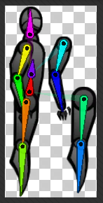
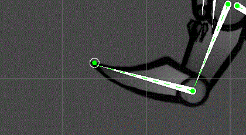
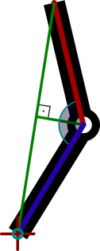

## Procedural animation showcase
_Unity 2D humanoid procedural animation (Unity 6000.3, 2D Animation IK, Input System)_

## 1. Overview
  This project explains a simple approach to procedural 2D leg animation for a bipedal character. It uses inverse kinematics (IK) to place each leg, so the legs adapt to the terrain. Walking, jumping, rolling, ledge climbing and aiming are all procedural: there are no animation clips.

  

_Results_

Open `Assets/Scenes/SampleScene.unity` and press Play.

| Action | Keyboard / mouse | Gamepad |
|---|---|---|
| Walk | A / D (or ← / →) | Left stick |
| Run (while walking, not while aiming) | Hold Left Shift | Press left stick |
| Jump (climbs instead when a too-high ledge is ahead) | Space | South button |
| Roll toward the facing direction (disabled by default) | C | East button |
| Shooting mode: face and aim at the pointer | Hold right mouse button | Left trigger |
| Fire (in shooting mode; logs a debug message) | Left mouse button | Right trigger |
| Open or close the locomotion tuning panel | F1 | |

## Project layout
```
Assets/
  Art/Characters/      inverseRobo.psb (rigged PSB character)
  Art/Sprites/         debug icons and the ground tile
  Scenes/              SampleScene
  Scripts/             ProceduralCharacter.Runtime assembly
    Character/         CharacterDriver (composition root), facing, kinematic motor, rig
    Character/States/  Walk, JumpWindup, Airborne, Roll, Climb and their settings
    Climbing/          ledge detection and grab rules
    Diagnostics/       locomotion inspector (tuning, telemetry, preview), presets, debug lines
    Diagnostics/DebugPanel/  the runtime Game View tuning panel (UI Toolkit)
    Input/             PlayerInputReader (actions defined in code), PlayerCommands, UiInputCapture
    Locomotion/        stride gait, gait clock and scheduler, leg steppers, foothold planning
    UpperBody/         locomotion posture, chest motion, head look, arm swing, two-bone arm IK, shooting
  Resources/LocomotionDebug/  the panel's theme and stylesheet
  Tests/EditMode/      tests for the pure policies and the gait timing
  Tests/PlayMode/      locomotion scenarios driven through virtual input devices
```

### How a frame runs
`CharacterDriver` (on the `inverseRobo` root) is the only component with an `Update`:
1. It reads one `PlayerCommands` snapshot from `PlayerInputReader`.
2. It ticks the active **full-body state**: Walk, JumpWindup, Airborne, Roll or Climb.
3. It ticks the **locomotion posture**: the sustained forward lean of the upper body.
4. If the state allows it, it ticks the **upper body** on top: the shooting stance (aiming, head look, firing) or the arm swing and level head, then the chest's secondary motion.
5. In `LateUpdate`, it applies this frame's arm and head pose requests. Any limb nobody posed eases back to its authored rest pose.

The full-body states switch through `CharacterStateMachine`. Each state receives a `StateContext` holding the machine, the `CharacterRig` (stride, facing, motor, arms, head, chest, posture root) and its sibling states.

| Piece | Responsibility |
|---|---|
| [StrideController](Assets/Scripts/Locomotion/StrideController.cs) | Grounded gait: moves the body at the ground speed, plans each foothold, steps the legs and carries the body over the feet. |
| [StepScheduler](Assets/Scripts/Locomotion/StepScheduler.cs) | The gait clock: when each leg lifts, how fast swings progress, starting and stopping. |
| [LegStepper](Assets/Scripts/Locomotion/LegStepper.cs) | Moves one leg's IK target: a lift-then-settle step arc, settling after a landing, or a free swing while airborne. |
| [FootholdPlanner](Assets/Scripts/Locomotion/FootholdPlanner.cs) / [FootholdProbe](Assets/Scripts/Locomotion/FootholdProbe.cs) | Pure scoring of foothold candidates / the physics queries that collect them. |
| [KinematicBodyMotor](Assets/Scripts/Character/KinematicBodyMotor.cs) | Moves the body by velocity while a hips-to-head capsule slides along walls and ceilings. |
| [CharacterFacing](Assets/Scripts/Character/CharacterFacing.cs) | Turns the character by mirroring the rig root in place. World-space targets keep their positions. |
| [ArmLimb](Assets/Scripts/UpperBody/ArmLimb.cs) / [TwoBoneIk](Assets/Scripts/UpperBody/TwoBoneIk.cs) | Per-frame arm reach requests solved by analytic two-bone IK. |
| [LedgeDetector](Assets/Scripts/Climbing/LedgeDetector.cs) / [LedgeGrabPolicy](Assets/Scripts/Climbing/LedgeGrabPolicy.cs) | Finding a climbable ledge / the pure grab windows and climb keyframes. |

## 2. Idea
  Each leg of the rigged character is a chain of two bones. Its end (the foot) reaches for a planned foothold once the step target moves out of range. To avoid unnatural, direct point-to-point movement of both legs, extra logic controls and syncs leg and body movement based on the environment and where the feet currently stand.

## 3. Character rig
  The leg rig is simplified to keep the calculations easy, and each bone drives one sprite. The legs use Unity's `LimbSolver2D`. The arms are posed by this project's own two-bone IK, and the head and chest bones are rotated directly.

  The hierarchy separates what moves the character from what poses it: `inverseRobo` (the `CharacterDriver` root) holds the kinematic `body` (`StrideController`), which only translates. Under it, the pelvis bone `bone_abs` is the posture root: the torso leans from there, carrying the thighs, chest, head and arms. The foot IK targets and solvers stay under `inverseRobo` in world space, so leaning or mirroring never drags a planted foot. [RigValidation](Assets/Scripts/Character/RigValidation.cs) reports a hierarchy that breaks these rules in the Console and in the inspector.

  

## 4. Planning footholds
  A foothold is chosen once, when a step starts, and the leg keeps it for the whole step.
  - **Collecting candidates:** `FootholdProbe` samples ground tops from the stride target back to the swinging foot, and a little beyond.
  - **Rejecting columns:** a column is dropped if its ray starts inside geometry, or if the swing path to it would pass through terrain (for example, the floor on the far side of a stair block).
  - **Validating:** `FootholdPlanner` accepts a candidate only if it is inside the step window around the planted foot, and only if it is within leg reach of where the hip will settle.
  - **Scoring:** the cheapest candidate wins, where cost = distance to the desired spot + height change. So:
    - narrow gaps are stepped across;
    - the floor deep under a gap is ignored;
    - a far, high ledge never beats a near foothold.

| `FootholdLimits` field | Default | Meaning |
|---|---|---|
| `maxStepUp` / `maxStepDown` | 1.0 / 1.3 | Step window around the planted foot |
| `maxReachStretch` | 1.2 | Allowed hip-to-foothold distance, as a multiple of leg length |
| `searchRadius` / `searchStep` | 0.8 / 0.05 | How far past the desired spot to sample, and how densely |
| `heightWeight` | 0.5 | Cost of height change relative to sideways shift |
| `minStepLength` | 0.15 | Shorter steps are skipped instead of shuffling |

  When no foothold exists, a fall starts if the body leans past its feet by more than `edgeOverhang`. A fall also starts if neither foot stands on ground.


## 5. Inverse kinematics
  IK computes the bone rotations that let a foot reach its target point.

  

  The simplified bone structure and the reduction to two dimensions remove nearly all the complex calculation. Basic trigonometry is enough, with no iterative matrix operations. The arms use the same idea in [TwoBoneIk](Assets/Scripts/UpperBody/TwoBoneIk.cs).

  

  _We know the lengths and positions of all the bones and line segments, so we can calculate the angle between the red and blue bones that reaches the target point._

## 6. Walking and running
  The body leads and the feet follow, timed by one gait clock ([StepScheduler](Assets/Scripts/Locomotion/StepScheduler.cs) over [GaitCycle](Assets/Scripts/Locomotion/GaitCycle.cs)):
  - **One clock for the lifts and the swings:** a phase in [0, 1) advances by distance travelled over a stride. The front leg is cued at phase 0 and the back leg at 0.5. Each swing also advances on that clock ([SwingTiming](Assets/Scripts/Locomotion/SwingTiming.cs)), through one shared swing share of the cycle, so a cued foot is always down by its cue, whatever the cadence does. Steps therefore alternate evenly through speed changes and walk/run changes. When a leg's own timer ran its swing instead, a change of cadence ended swings early or late, a delayed lift made one interval short and the next long, and the gait limped.
  - **Speed sets step length and cadence:** both grow with the square root of speed ([GaitTiming](Assets/Scripts/Locomotion/GaitTiming.cs)), as people keep step length over cadence roughly constant (the "walk ratio"). That gives short, slow steps when starting and stopping, about two steps a second walking and about three running.
  - **Stance and swing:** each foot spends a duty-factor share of the cycle on the ground: about 0.6 walking, so a foot is always down, and about a third running, so both feet leave the ground between steps. Going from one to the other, the swing share ramps steadily per cycle (`swingShareChangePerCycle`), so every contact interval shifts by the same small amount instead of one interval stretching. The other foot may lift once a swing is far enough along: late when walking, mid-swing when running. That release point is fixed for each step when it lifts.
  - **The gait follows the speed:** the run input only raises the target speed. The walk/run blend ([LocomotionPace](Assets/Scripts/Locomotion/LocomotionPace.cs)) follows the speed the body actually reaches, over a band of the walk-to-run speed range. So run timing never applies at walking speed, and posture, bob and arm swing grow with the pace (`Moving`) on a fixed scale: full walk is the walk profile and full run is the run profile.
  - **Planning a step:** [SwingForecast](Assets/Scripts/Locomotion/SwingForecast.cs) replays the speed ramp and the clock-driven swing from the lift. The foot then lands where the hip will be at touchdown (riding its spring's steady lag), plus its contact lead, whether the body is speeding up, cruising or stopping. A step already in the air is re-planned when the intended speed changes, so releasing the run key mid-stride doesn't land the foot far ahead of the stopping body. A stopping step lands on the stance spot the other foot left free.
  - **Asymmetric stance:** the stance travel (duty factor × stride) is split by `contactLeadShare` into a contact lead ahead of the hip and a toe-off lag behind it. Walking centres the stance (0.5). Running lands about a third of it ahead, close under the body, and pushes off far behind, so the push-off leg straightens out behind the hip.
  - **Keeping up:** a planted foot trailing a little further than a normal stance quickens the cadence (`catchUp`), so the next steps come sooner while the legs stay half a cycle apart. A foot that would trail beyond its leg's reach by the time the clock cues it quickens the cadence from the start of its stance. Setting off, swings are timed for the intended speed (`settingOffShare`), so the first stances of a run keep the run's rhythm. Only a foot far behind (`emergencyMargin`) takes an out-of-turn balance step, which re-phases the clock when it lifts, and never twice within `emergencyCooldown` ([SupportRecovery](Assets/Scripts/Locomotion/SupportRecovery.cs)).
  - **Starting and stopping:** stepping starts above `startSpeed` and stops below the lower `stopSpeed`, so a speed hovering near a threshold can't restart the gait every frame. From a stance the trailing foot steps first. After a brief stop or a turn, the leg that did not step last continues the rhythm. Walking always begins from the stance the feet were just placed in (spawning, landing, after a roll or a climb).
  - **Standing:** the robot stands tall on nearly straight legs (`bodyHeight`). Walking sinks the pelvis a little and running more (`pelvisDrop`). Once the body has come to rest, the feet take settling steps into a stance centred under the torso, slightly ahead of the pelvis (`stanceLead`). If both feet are off their spots, the leg that did not step last goes first.
  - **Edges:** a foot that finds no foothold ahead leaves the body leaning past its feet, and it falls. Stopping near a ledge keeps it on the ledge.

  Walk and run are each a [GaitProfile](Assets/Scripts/Locomotion/GaitProfile.cs) on `StrideController`, with their own acceleration and braking: walking eases in, running starts and stops sharply. The timing of transitions is in [GaitTransitionSettings](Assets/Scripts/Locomotion/GaitTransitionSettings.cs) and [BalanceSettings](Assets/Scripts/Locomotion/BalanceSettings.cs).

  

## 7. Moves
  - **Jump:**
    - A short crouch (`JumpWindupState`), then a launch tuned by apex height.
    - In the air, the character can steer, and the legs tuck while rising and reach while falling.
    - Coyote time and a jump buffer make timing forgiving.
    - Landing is swept over the whole frame's fall, so a long frame cannot tunnel through the ground.
  - **Roll** (a dive roll in four procedural phases, each easing from where the previous one left off):
    1. **Dive:** forward momentum, the torso pitches forward and drops, both arms stretch ahead and the trailing leg pushes back.
    2. **Hand contact:** the hands reach for ground probed ahead of the shoulders. The phase ends when the hand actually reaches it (with a timeout).
    3. **Roll:** the hands stay planted briefly, then tuck. The body turns the rest of the way to 360° while its lowest point (head, shoulders, back or hips) stays on the ground, so it rolls like a ball over uneven steps. The chest curls and the chin tucks only while the body is inverted, which swings the head up and away from the ground.
    4. **Recovery:** the feet reach for ground within a step of where the robot rolled, sliding toward the body near edges. The body rises into a slight crouch that the walking gait stands out of.

    The roll stops at walls and turns into a fall if it leaves a ledge.
  - **Climb:**
    - **Trigger:** pressing jump next to a ledge too high to step onto (up to `maxGrabRise`) starts a climb. So does reaching a ledge corner in the air.
    - **Sequence:** the character reaches the corner, hangs, pulls up while the feet scramble on the wall face, mounts a foot on top and stands.
    - **Detection:** a ledge needs standing room above it and at least `minTopDepth` of top.
  - **Shooting mode:**
    - Holding aim turns the character toward the pointer (it can backpedal), extends the front arm toward it and tilts the head to follow.
    - Fire calls `Pistol.TryFire`. For now that logs a debug message and draws a debug ray from the muzzle.
    - Shooting is suppressed while rolling and climbing.

  All tunables are serialized on `CharacterDriver`, grouped by move. Ease values are fractions per 60 Hz frame and are converted to the actual frame time by `FrameRateEase`.

  

## 8. Weight and feel
  The body moves in step with the legs, from the same gait phase ([GaitWaves](Assets/Scripts/Locomotion/GaitWaves.cs)), while the upper body carries its inertia:
  - **Bob:** twice per stride. When walking, the body is lowest just after each foot lands (the knee takes the weight) and highest passing over the supporting leg. When running, it is lowest mid-stance and highest in flight. The planted legs' reach is a hard ceiling: the hips never rise beyond what the planted legs reach.
  - **Support-driven pelvis** ([SupportLegResolver](Assets/Scripts/Locomotion/SupportLegResolver.cs), [PelvisSupportMotion](Assets/Scripts/Locomotion/PelvisSupportMotion.cs)): the pelvis target is the stride anchor plus a support offset plus a surge. The support offset pulls the pelvis toward where the hip should be over the support foot at this point of its stance (`supportCoupling`, at most `maxSupportOffset`). The surge carries the body forward through the first half of each stance and back through the second, so it travels through the legs instead of on a rail above them. Both are zero at contact and toe-off.
  - **Posture** ([LocomotionPosture](Assets/Scripts/UpperBody/LocomotionPosture.cs)): the pelvis bone (`bone_abs`) carries the sustained forward lean, so the whole torso tilts as one line from the hips, with no bend at the waist. The lean grows with the pace from the idle lean to the walk's (3.5°) and the run's (17°), plus a lean into acceleration (back when braking), within a cap (`maxTotalLean`, 22°). It follows through a slow, critically damped spring, so it never pumps with the steps, and it relaxes upright in the air, rolling or climbing. The kinematic body pivot itself never tilts.
  - **Chest** ([TorsoMotion](Assets/Scripts/UpperBody/TorsoMotion.cs)), small secondary motion on top of the posture:
    - it flexes forward as weight is taken and extends over the supporting leg (0.6° walking, 1° running);
    - when standing still it breathes ([Breathing](Assets/Scripts/UpperBody/Breathing.cs)): each in-breath raises the chest along the spine and extends it, lifting the shoulders, arms and head, and the out-breath is slower;
    - it kicks back with recoil.
  - **Head** ([HeadLook](Assets/Scripts/UpperBody/HeadLook.cs)): holding level or aiming, it cancels a share of the torso's tilt at once (`stabilization`: 0 rides the torso, 1 stays level; 0.35 by default), so it stays steady through the steps while still following the body line of a lean. Only the requested look or tuck goes through a spring.
  - **Arms** ([ArmSwing](Assets/Scripts/UpperBody/ArmSwing.cs)):
    - they swing opposite to the legs, the hand dragging a little behind the shoulder;
    - they swing about plumb, like pendulums, so a leaning run does not carry the swing back with the torso: the rear hand stays near the hip;
    - the elbows flex on the forward swing; when running they stay bent and pump;
    - winding up a jump they swing back, and in the air they rise for balance.
  - **Mass:** the body follows its target through [SecondOrderDynamics](Assets/Scripts/Locomotion/SecondOrderDynamics.cs) springs ([BodyCarriage](Assets/Scripts/Locomotion/BodyCarriage.cs)), with three perceptual parameters (t3ssel8r's formulation): `frequency`, `damping` and `response`. The vertical spring (6 Hz) sits well above the running step rate (about 3 a second), so it follows the bob closely rather than being driven near its own frequency into an uncontrolled bounce. Foot plants and push-offs add only a little firmness, and a landing's speed becomes the squash and rebound.
  - **Steps:** the foot follows [StepArc](Assets/Scripts/Locomotion/StepArc.cs) curves, one set for walking and one for running:
    - walking, the toe clears early in the swing, the foot passes under the hip near the top, then lowers gently and comes to rest as it touches down;
    - running, the heel recovers behind the body, then the knee drives up: the foot peaks under the hip a little past mid-swing, with the thigh swung up in front, and comes down hard close under the body.
  - **Air:** falls are heavier than rises, with a brief hang at the apex.
  - **Camera and events:** [FollowCamera](Assets/Scripts/Character/FollowCamera.cs) follows with spring lag and look-ahead and kicks on landings. [CharacterEvents](Assets/Scripts/Character/CharacterEvents.cs) (`FootPlanted`, `Landed`, `Jumped`, `Fired`) are the place to attach sound and VFX.

## 9. Runtime tuning panel
  Press **F1** in Play Mode to open the locomotion panel in the Game View. Press it again to close it, or use **–** to collapse it to its header. The `LocomotionDebugPanel` object in the scene holds the key and the character reference. Hidden, the panel only waits for its key. Open, clicks over it and typing into its fields don't reach gameplay. A field holds the keyboard only after you click into it, and clicking outside gives it back.
  - **LIVE:** what the gait is doing, in sections:
    - **Gait:** classification (IDLE, WALK, RUN or TRANSITION), input, ground and intended speed, pace and run blend.
    - **Timing:** gait phase, cycle period and cadence, duty factor and swing share, catch-up, the last planted foot, the front-to-back and back-to-front contact intervals, and the balance step and resync counts.
    - **Support:** the support leg (front, back, both feet or flight), the support foot's X and stance progress, the contact lead share, the pelvis X against its target and the stride anchor, and the support offset and surge.
    - **Height:** pelvis Y and target, the gait baseline and bob, and the reach ceiling (marked when it limits the pelvis).
    - **Legs:** the measured leg length, and each leg's state, hip-to-foot distance and extension.
    - **Posture:** the gait lean and acceleration lean, the total lean target and actual, chest pitch and head stabilization.

    Flags light up for 1.5 s after a **BALANCE STEP**, a **PHASE RESYNC** or a **FOOTHOLD FAILED**. The preview at the top (Auto, Idle, Walk, Run, with an optional speed) drives the gait without input. Auto is the normal game, and a badge in the header shows while a preview is active.
  - **IDLE:** the stance, settling steps, idle lean, breathing and the start and stop thresholds.
  - **WALK / RUN:** every value of that gait profile: speed, timing, pelvis and body, base lean, secondary pitch and arm swing.
  - **TRANSITIONS:** the walk/run blend band and rate, the swing share ramp (cadence transition), the setting-off planning share, the lift overlaps, balance recovery (catch-up and emergency step), the posture's acceleration response and blend speed, and the idle thresholds.
  - **BODY:** body height, leg extension, reach drop, the plant impulse cap and the horizontal and vertical springs.
  - **UPPER BODY:** the walk and run leans and secondary pitch, the acceleration lean and caps, head stabilization, arm swing and the posture, chest, head and arm springs.
  - **DEBUG:** toggles for lines showing the foot and IK targets, planned footholds (the swinging foot's next foothold), body target, stride anchor, support range, pelvis, posture direction, ground probes, the support leg (support foot to its hip), the gait phase, the pelvis path, and the pelvis offsets (anchor, support offset and surge). The lines show in the Scene view, and in the Game view while its **Gizmos** toggle is on.

  Each value has a slider, its exact value, a number field and its unit, and changes take effect at once. **Reset section** and **Reset all** restore the values the session started with. **Save preset** and **Load preset** write and read JSON files in `Application.persistentDataPath/LocomotionPresets` (on Windows, `%USERPROFILE%/AppData/LocalLow/<company>/<product>/LocomotionPresets`). **Copy current config** puts the JSON on the clipboard. Tuning never touches assets: in the Editor the changes end with Play Mode, so to keep values, copy them into the scene's `StrideController` and `CharacterDriver` settings. Debug tools reach all of this through `CharacterDriver.Inspector`; the locomotion never reads it back.

## 10. Tests
  Open the Test Runner (Window ▸ General ▸ Test Runner).
  - **EditMode** tests cover the pure policies: foothold planning, two-bone IK, ledge grab rules, jump math, frame-rate easing, the gait cycle, timing and pace, step arcs, breathing, springs, posture lean, presets and the tuning schema. Simulations through the production timing classes check that walk to run and run to walk, from any point of either swing, keep the legs alternating, lift on cue and land evenly.
  - **PlayMode** tests load the sample scene on a long test track and drive the character with a virtual keyboard and mouse at a fixed 60 fps. They cover idle, walk and run, transitions at every point of the stride, run toggles, starts and stops, reversals, the full run, uneven ground, jumps, landings, climbing, aiming, the panel, the preview and the telemetry. `RunPoseTests` measures the full run against a reference sprinter: the torso leaning 15–25° without a waist bend, the push-off leg straight and far behind the hip, the knee drive, and the hands' range in front and behind. Each scenario writes its measurements to `Temp/LocomotionScenarios/<test>.txt`: contact evenness, phase jumps, balance steps, lean, body height, flight, head steadiness and planted-foot reach.

## 11. Todo
  - [ ] Character and ground prefabs
  - [ ] Footstep and landing sounds and dust on `CharacterEvents`
  - [ ] Projectiles and hit reactions for the pistol
  - [ ] Foot alignment to slopes
  - [ ] Step curves as `AnimationCurve`s
  - [ ] Allow the character to fall over when losing balance
  - [ ] Remove the legacy `RaycastTarget` components and their `rayTargetLeg*` marker objects from the scene
